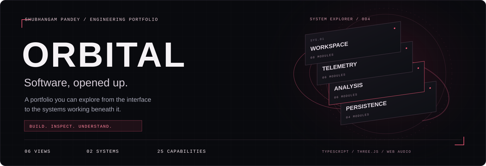
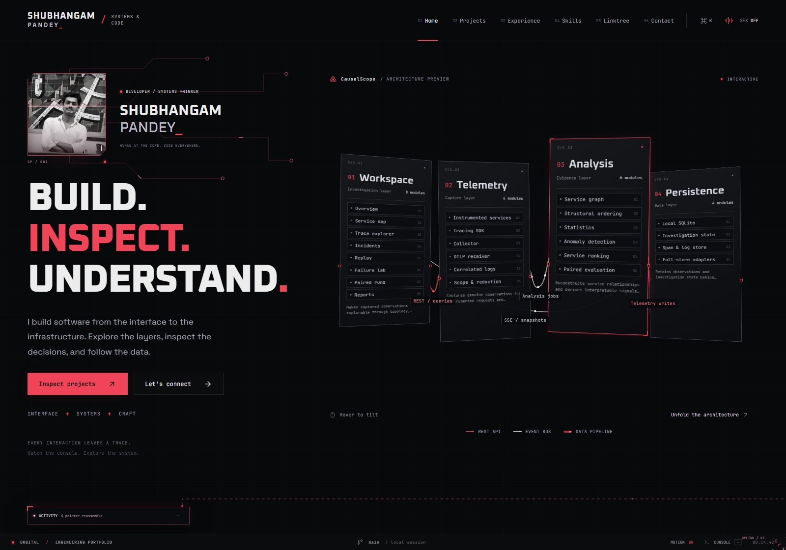
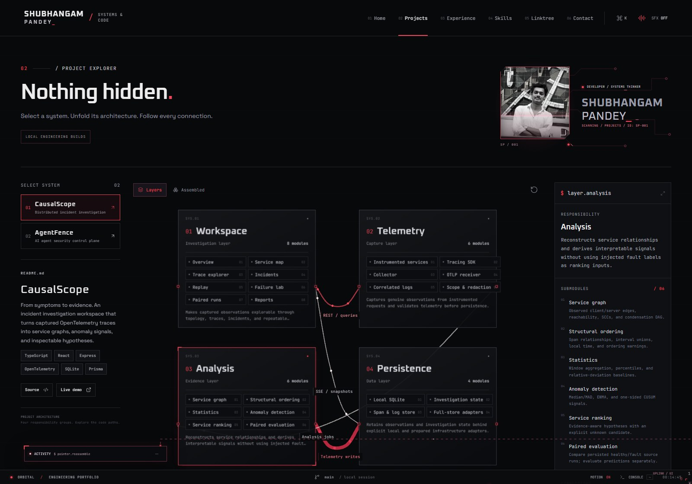
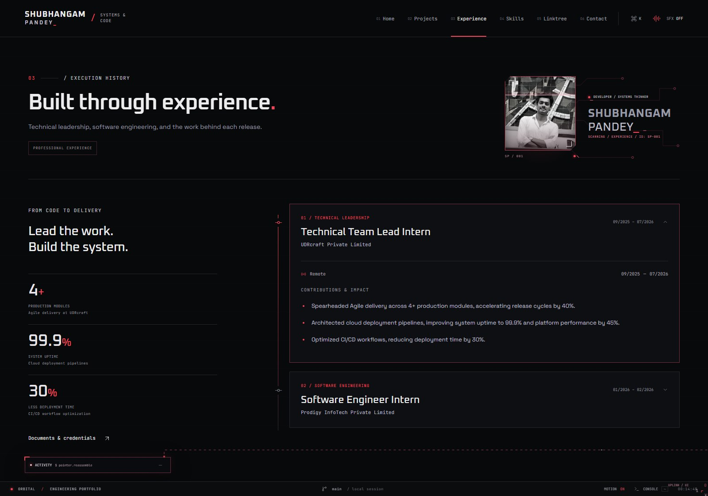
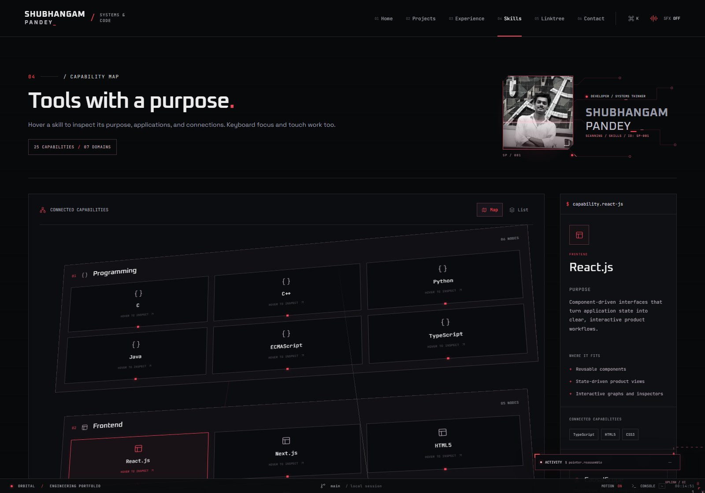
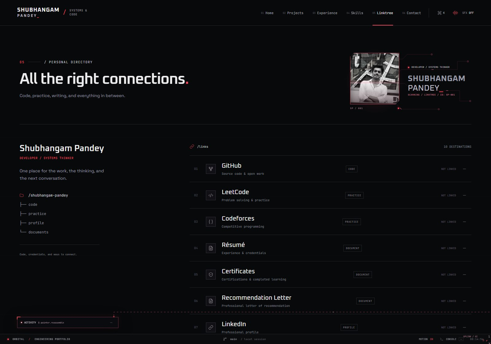
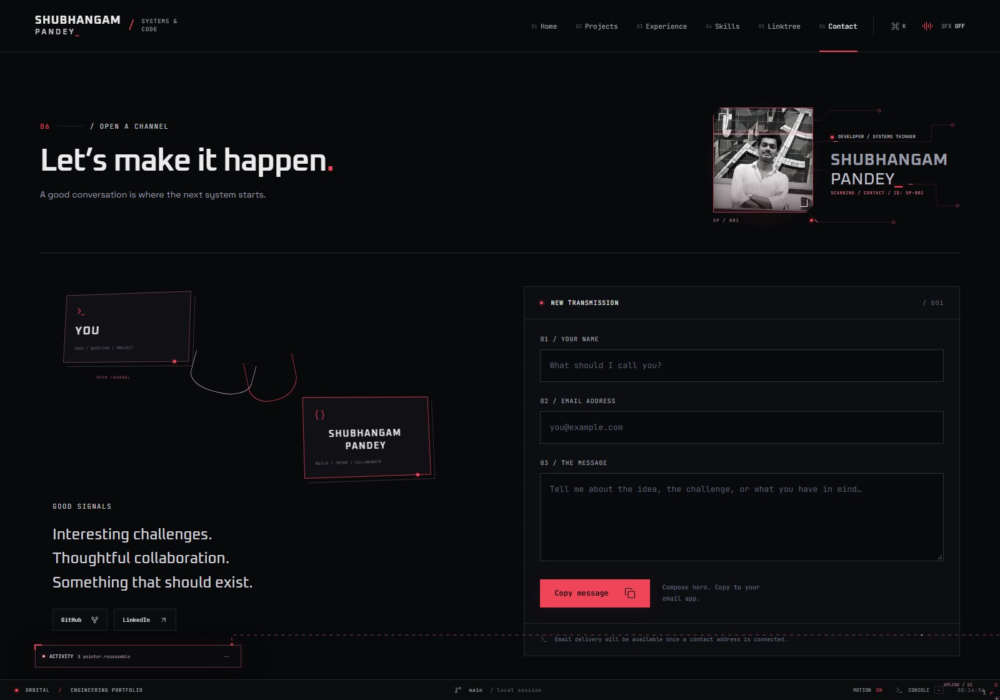
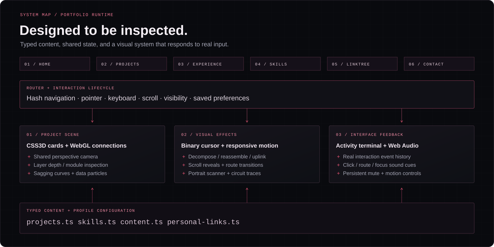
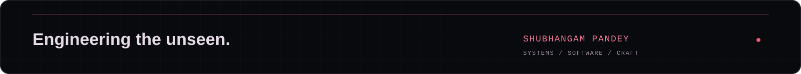

<p align="center">
  
</p>

<h1 align="center">Engineering the unseen.</h1>

<p align="center">
  An interactive portfolio by <strong>Shubhangam Pandey</strong>.<br />
  Explore the interface. Unfold the architecture. Follow the decisions behind the work.
</p>

<p align="center">
  <a href="#visual-tour">Visual tour</a> ·
  <a href="#the-experience">Experience</a> ·
  <a href="#architecture">Architecture</a> ·
  <a href="#featured-systems">Projects</a> ·
  <a href="#run-locally">Run locally</a> ·
  <a href="https://github.com/shubhangampandey">GitHub</a>
</p>

---

## Overview

**ORBITAL turns a developer portfolio into an inspectable system.** Project cards separate into responsibility layers. Connections distinguish API requests from event flows and persistence pipelines. A floating terminal records the visitor's actions while a binary cursor, circuit traces, and synthesized audio give the interface a consistent technical character.

The visual language is black, white, and crimson: precise typography, restrained illumination, readable panels, and motion tied to interaction. The site brings together professional experience, engineering case studies, technical capabilities, credentials, and contact in six connected views.

The portfolio itself is a **TypeScript application built with Vite, Three.js, native browser APIs, and Lucide**. React, Express, databases, and other technologies described in the project case studies belong to those showcased systems or to the skills directory.

## Visual tour

Actual screenshots from this repository. The terminal is manually minimized in these captures to keep the underlying content visible.

<table>
  <tr>
    <td width="50%">
      <a href="docs/readme/home.jpg"></a>
      <strong>01 / Home</strong><br />Identity, engineering perspective, and a live architecture preview.
    </td>
    <td width="50%">
      <a href="docs/readme/projects.jpg"></a>
      <strong>02 / Projects</strong><br />Exploded layers, inspectable modules, and engineering notes.
    </td>
  </tr>
  <tr>
    <td>
      <a href="docs/readme/experience.jpg"></a>
      <strong>03 / Experience</strong><br />Professional roles, responsibilities, and supplied impact metrics.
    </td>
    <td>
      <a href="docs/readme/skills.jpg"></a>
      <strong>04 / Skills</strong><br />Twenty-five capabilities, seven domains, and contextual evidence.
    </td>
  </tr>
  <tr>
    <td>
      <a href="docs/readme/linktree.jpg"></a>
      <strong>05 / Linktree</strong><br />Code, practice, résumé, certificates, and recommendation letter.
    </td>
    <td>
      <a href="docs/readme/contact.jpg"></a>
      <strong>06 / Contact</strong><br />A direct channel for project enquiries and collaboration.
    </td>
  </tr>
</table>

## The experience

### Software architecture you can unfold

Each featured project has **four responsibility groups**, with descriptions, submodule counts, and inbound/outbound connections. Hover introduces perspective and depth; scrolling or the expansion control separates the layers. The fully expanded state places them in a readable two-by-two arrangement.

Thin connections represent calls and event flows. Thicker tubes represent data pipelines. Cables sag and sway, with traveling particles illustrating movement between the groups. Select a layer or module to inspect its purpose in the adjacent panel.

The architecture descriptions are authored from the showcased projects. The animated connections explain their structure; they do not represent live production traffic.

### A terminal that follows the interaction

The floating activity console records navigation, focus, architecture inspection, form activity, and other interface events. It starts expanded, preserves its state across route changes and browser focus changes, and minimizes only when its minus button is clicked.

On desktop, drag the title bar or restore its dock. The Console control, command palette, and backtick key reopen it. Its command-style output is a visual record of interface events, with no operating-system shell access.

### Binary cursor and connected motion

Mouse movement leaves a trail of `0` and `1` fragments. The cursor repeatedly decomposes and reassembles; after assembly, an animated tether reconnects it to the terminal. Every click starts a new burst, including clicks on empty space.

Scroll reveals, a traveling crimson scan, route acquisition effects, and varied hover responses share the same visual language. The effects overlay never intercepts input. Mouse support also works in narrow desktop windows; touch input retains its normal interaction.

### Sound tied to real actions

The Web Audio engine synthesizes distinct cues for clicks, navigation, selection, unfolding, and tab exit/return. Hover ticks are throttled independently so they cannot swallow a page-change cue. Quiet ambience pauses while away and resumes on return.

**SFX and motion start ON for new visitors.** Either can be disabled explicitly, and that preference survives refreshes. Browsers that restrict autoplay unlock audio on the first click, tap, or keypress. Motion OFF restores the native cursor and static presentation.

### One identity across every page

The supplied portrait appears in a grayscale circuit frame with a scanning sweep, corner markers, and traveling signal traces. Every non-home introduction reuses the same identity component, positioned at the upper right on desktop and labeled for the current page.

The capability inspector updates on **hover or keyboard focus**, with click selection for touch. It explains each skill's purpose, applications, related capabilities, and relevant project implementation or configuration. No percentage-based proficiency ratings are used.

### Controls at a glance

| Input | Result |
| :--- | :--- |
| Hover a project layer | Tilt the architecture and preview focus |
| Scroll the project workspace | Separate the responsibility layers |
| Select **Layers** or use the depth slider | Bring all layers into the reading plane |
| Select a module | Open its responsibility and connection details |
| Hover or focus a skill | Update the contextual inspector |
| `Ctrl / Cmd` + `K` | Open the command palette |
| Backtick or **Console** | Open the activity terminal |
| Terminal minus button | Minimize the console explicitly |
| **SFX** / **Motion** | Change and save the interaction preference |

On mobile, readable touch-selectable architecture groups replace the desktop 3D scene.

## Architecture

<p align="center">
  
</p>

| Concern | Implementation |
| :--- | :--- |
| Application | TypeScript, ES modules, and six hash-routed views |
| Development and build | Vite; type checking runs before the production build |
| Project rendering | Three.js `CSS3DRenderer` for HTML cards and WebGL for connection meshes |
| Spatial consistency | HTML layers and cable geometry share a perspective camera |
| Cable motion | Curved connection paths, decorative sway, and traveling particles |
| Interface effects | Canvas 2D cursor and scan effects; CSS and Web Animations API transitions |
| Audio | Web Audio oscillators, gain envelopes, and lifecycle-aware playback |
| Iconography | Lucide |
| Typography | Self-hosted Oxanium, JetBrains Mono, and Space Grotesk |
| Verification | Playwright browser suites and TypeScript checking |

The scene is loaded when needed and disposed when leaving its route. Visibility handling limits background visual work, while the terminal and sound engine maintain continuity across navigation. Content, skills, project descriptions, and external destinations are separated from presentation code.

The portfolio is a static frontend. It does not require a database, API key, account, or application server.

## Featured systems

### CausalScope

**Distributed incident investigation · 4 responsibility groups · 24 modules**

CausalScope connects captured OpenTelemetry observations with service topology, trace inspection, anomaly signals, and evidence-aware incident investigation. Eight instrumented HTTP services provide observations for bounded workloads and controlled experiments.

Its workspace covers service maps, waterfalls, incidents, replay windows, paired healthy/fault runs, and exported reports. Analysis includes structural ordering, percentiles, median/MAD, EWMA, CUSUM, and inspectable service-ranking hypotheses.

| Workspace | Telemetry | Analysis | Persistence |
| :--- | :--- | :--- | :--- |
| Investigation and reports | SDK observations and ingestion | Graph reconstruction and signals | Observations and investigation state |
| 8 modules | 6 modules | 6 modules | 4 modules |

**Project stack:** TypeScript, React, Express, OpenTelemetry, SQLite, Prisma.

<details>
<summary><strong>Implementation scope</strong></summary>

The documented verified local storage path is SQLite. PostgreSQL and ClickHouse adapters and Docker configuration are prepared; that full-storage path was not runtime-verified on the development host. Service rankings are hypotheses supported by observations, rather than proof of causation.

</details>

### AgentFence

**AI agent security control plane · 4 responsibility groups · 21 modules**

AgentFence places an authoritative gateway between an AI agent and its tools. Scoped identities, resource grants, default-deny OPA/Rego policy, payload-bound independent approval, and current-state authorization rechecks govern execution.

Transactional idempotency and signed audit links make invocation state and decisions inspectable. Operator workflows include policy simulation, approval review, investigations, and reproducible adversarial gateway experiments.

| Workspace | Gateway | Policy & tools | Evidence |
| :--- | :--- | :--- | :--- |
| Operator workflows and review | Identity, contracts, and enforcement | Decisions and synthetic connectors | Invocation records and audit links |
| 6 modules | 5 modules | 6 modules | 4 modules |

**Project stack:** TypeScript, React, Express, PostgreSQL, Prisma, OPA/Rego.

<details>
<summary><strong>Implementation scope</strong></summary>

Connectors operate on synthetic CRM, payment, and document data. PostgreSQL-compatible PGlite is a development fallback. AgentFence is a portfolio security implementation, not a certified enterprise service.

</details>

## About the developer

**[Shubhangam Pandey](https://github.com/shubhangampandey)** — developer and systems thinker, building from the interface to the infrastructure.

### Professional experience

**UDRcraft Private Limited · Technical Team Lead Intern**<br />
September 2025 – July 2026 · Remote

- Led Agile delivery across **4+ production modules**, accelerating release cycles by **40%**.
- Architected cloud deployment pipelines, improving system uptime to **99.9%** and platform performance by **45%**.
- Optimized CI/CD workflows, reducing deployment time by **30%**.

**Prodigy InfoTech Private Limited · Software Engineer Intern**<br />
January 2026 – February 2026 · Remote

### Capabilities

The site presents **25 capabilities across seven domains**, with contextual explanations and project associations where supported by the implementation or configuration.

| Domain | Capabilities |
| :--- | :--- |
| Programming | C, C++, Python, Java, ECMAScript, TypeScript |
| Frontend | React.js, Next.js, HTML5, CSS3, Tailwind CSS |
| Backend | FastAPI, Node.js, Express.js |
| DevOps | Docker, CI/CD, GitHub Actions |
| System design | HLD/LLD fundamentals, scalability, caching, load balancing |
| Cloud platforms | AWS fundamentals |
| Databases | MongoDB, PostgreSQL, MySQL |

## Run locally

Use Node.js **20.19+ within the 20.x release line, or 22.12+**, matching the installed Vite package's engine requirement, and npm.

```bash
git clone https://github.com/shubhangampandey/orbital-portfolio.git
cd orbital-portfolio
npm ci
npm run dev
```

Open the local address printed by Vite, normally `http://127.0.0.1:5173/`.

```bash
# Type-check and create the static production build
npm run build

# Serve that build locally
npm run preview
```

The generated site is in `dist/`. Serve it over HTTP; opening `index.html` directly from the filesystem is not supported.

## Personalize the portfolio

**Every editable external destination lives in [`src/personal-links.ts`](src/personal-links.ts).**

| Destination | Configuration |
| :--- | :--- |
| Contact address | `email` — address only, without `mailto:` |
| Résumé | `resume` — hosted document URL or a local public asset |
| Code and practice | `github`, `leetcode`, `codeforces` |
| Professional profile and writing | `linkedin`, `blog` |
| Credentials | `certificates`, `recommendation` |
| CausalScope | `projects.causalscope.source`, `projects.causalscope.demo` |
| AgentFence | `projects.agentfence.source`, `projects.agentfence.demo` |

To include a résumé PDF, add it as `public/resume.pdf` and set `resume` to `/resume.pdf`. Certificate collections can use a public folder URL; the recommendation entry can point directly to its document. Empty destinations remain visibly **NOT LINKED** rather than opening a fabricated URL.

Other editable content is organized by purpose:

- [`src/content.ts`](src/content.ts): name, role, summary, portrait path, and professional experience.
- [`src/projects.ts`](src/projects.ts): project narratives, responsibility groups, modules, and scope boundaries.
- [`src/skills.ts`](src/skills.ts): capability descriptions, applications, and project associations.
- [`public/images/`](public/images/): supplied portrait asset; its scan, frame, and circuits are implemented in code.

The contact form validates input. With an email configured, it opens a draft in the visitor's email application. Without one, it copies a formatted message. The static site does not send mail independently or claim that a message was delivered.

## Verification

```bash
# Install the browser used by the test suite
npx playwright install chromium

# Check types and build the application
npm run build

# Exercise the production preview
npm test

# Exercise Vite's development pipeline
npm run test:dev
```

Playwright covers route rendering, runtime errors, layer and module inspection, scroll expansion, terminal controls, command navigation, hover/focus skill summaries, responsive overflow, portrait placement, motion preferences, and contact composition. Audio checks exercise real Web Audio contexts for default-on playback, click/navigation cues, lifecycle recovery, and persistent mute.

The test configurations start or reuse their local servers: production preview on port `5174`, development on `5173`.

## Deployment

Build with `npm ci` followed by `npm run build`, then publish **`dist/`** to a static host. Hash routing keeps page navigation independent of server-side route rewrites.

The current public asset paths target a domain root. For a GitHub Pages project URL under a repository subpath, configure Vite's base and adjust the root-relative font, portrait, and document paths before publishing. A GitHub repository containing the source and README does not, by itself, deploy the site.

## Repository map

```text
orbital-portfolio/
├── docs/readme/             # Custom README graphics and interface screenshots
├── public/
│   ├── fonts/              # Local typefaces and their licenses
│   └── images/             # Portrait asset
├── src/
│   ├── main.ts             # Application shell, routes, and interaction wiring
│   ├── content.ts          # Profile and professional experience
│   ├── personal-links.ts   # All editable external destinations
│   ├── projects.ts         # CausalScope and AgentFence architecture content
│   ├── project-view.ts     # Engineering case studies
│   ├── skills.ts           # Capability directory
│   ├── skills-view.ts      # Hover/focus inspector
│   ├── identity-view.ts    # Shared portrait and circuit frame
│   ├── experience-view.ts  # Professional timeline
│   ├── scene.ts            # CSS3D layers and WebGL connections
│   ├── effects.ts          # Binary cursor, reveals, and route effects
│   ├── terminal.ts         # Activity history, docking, and manual minimization
│   ├── audio.ts            # Synthesized cues and audio lifecycle
│   └── *.css               # Responsive visual system and local font declarations
├── tests/                  # Playwright interaction and regression suites
├── index.html
└── package.json
```

## Design credits

Interface icons use **Lucide**. Typography uses **Oxanium**, **JetBrains Mono**, and **Space Grotesk**, with their bundled licenses in [`public/fonts/`](public/fonts/). README artwork is repository-local SVG; interface screenshots are captured from this application. The documentation does not depend on external badge or image-generation services.

---

<p align="center">
  
</p>

<p align="center">
  <a href="https://github.com/shubhangampandey">Shubhangam Pandey</a> ·
  <a href="#engineering-the-unseen">Back to top</a>
</p>
