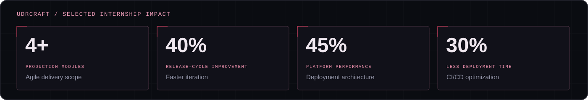
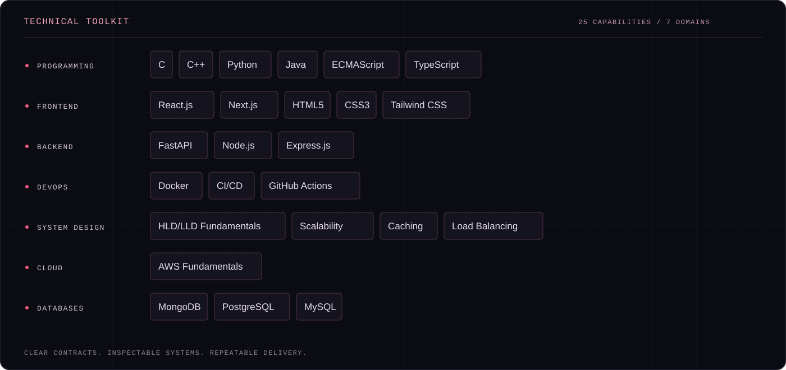

  

<h1 align="center">Hi, I'm Shubhangam Pandey.</h1>

  <strong>Software engineer · Full-stack developer · Systems thinker</strong> 
  I turn complex requirements into clear interfaces, dependable services, and inspectable systems.

  <a href="#about-me">About</a> ·
  <a href="#professional-experience">Experience</a> ·
  <a href="#technical-toolkit">Skills</a> ·
  <a href="#selected-work">Selected work</a> ·
  <a href="https://github.com/shubhangampandey?tab=repositories">Repositories</a>

<!-- PERSONAL LINKS — add these to the Connect section when their URLs are ready:
[Portfolio](YOUR_PORTFOLIO_URL)
[Résumé](YOUR_RESUME_URL)
[LinkedIn](YOUR_LINKEDIN_URL)
[Certificates](YOUR_CERTIFICATES_URL)
[Recommendation letter](YOUR_RECOMMENDATION_LETTER_URL)
[Email](mailto:YOUR_EMAIL)
These placeholders are intentionally hidden from the rendered profile.
-->

## About me

I'm a software developer with experience in **technical leadership, full-stack development, cloud deployment pipelines, and CI/CD optimization**. I enjoy working across the full path of a product: how people use it, how services communicate, how data is stored, and how changes reach production.

My work includes **distributed incident investigation** and **policy-driven security for AI agent workflows**. These projects reflect how I approach engineering: make responsibilities explicit, follow the evidence, and keep important decisions understandable.

I care about software that is useful on the surface and well reasoned underneath. Clear contracts, observable behavior, and repeatable delivery are central to the way I build.

  

## Professional experience

### UDRcraft Private Limited

**Technical Team Lead Intern** · Remote 
**September 2025 – July 2026**

- Spearheaded Agile delivery across **4+ production modules**, accelerating release cycles by **40%**.
- Architected cloud deployment pipelines, improving system uptime to **99.9%** and platform performance by **45%**.
- Optimized CI/CD workflows, reducing deployment time by **30%**.

### Prodigy InfoTech Private Limited

**Software Engineer Intern** · Remote 
**January 2026 – February 2026**

## Technical toolkit

My toolkit spans application development, infrastructure, and the system-design fundamentals that connect them.

  

<strong>View the complete skill directory</strong>

| Domain | Technologies & concepts |
| :--- | :--- |
| Programming | C, C++, Python, Java, ECMAScript, TypeScript |
| Frontend | React.js, Next.js, HTML5, CSS3, Tailwind CSS |
| Backend | FastAPI, Node.js, Express.js |
| DevOps | Docker, CI/CD, GitHub Actions |
| System design | HLD/LLD fundamentals, scalability, caching, load balancing |
| Cloud platforms | AWS fundamentals |
| Databases | MongoDB, PostgreSQL, MySQL |

## Selected work

### CausalScope · Distributed incident investigation

An investigation workspace that connects **OpenTelemetry observations, service relationships, trace inspection, and anomaly signals** to help explain distributed-system failures.

- Captures observations from **eight instrumented HTTP services** and makes them explorable through service maps, trace waterfalls, and correlated logs.
- Combines structural analysis, MAD/EWMA/CUSUM signals, controlled fault experiments, and paired-run comparisons.
- Keeps rankings tied to inspectable evidence and makes uncertainty explicit.

**Built with:** TypeScript · React · Express · OpenTelemetry · SQLite · Prisma

### AgentFence · Security for AI agent workflows

A deterministic control plane that places **identity, authorization, independent approval, and execution evidence** between an AI agent and its tools.

- Enforces scoped machine identities, resource boundaries, and **default-deny OPA/Rego policies**.
- Binds approvals to exact request payloads and rechecks authorization before execution.
- Combines transactional idempotency, signed audit links, policy simulation, and adversarial evaluation using synthetic connectors.

**Built with:** TypeScript · React · Express · PostgreSQL · Prisma · OPA/Rego

### ORBITAL · My interactive portfolio

A personal portfolio that makes my work explorable through **3D project layers, labeled connections, hover-driven skill summaries, and an event-aware terminal**. Its black, white, and crimson identity combines circuit-framed portraits, binary cursor effects, and synthesized interaction audio.

**Built with:** TypeScript · Three.js · Vite · Web Audio API · CSS 
**[Explore the portfolio repository →](https://github.com/shubhangampandey/orbital-portfolio)**

## How I approach engineering

| Principle | What it means in my work |
| :--- | :--- |
| **Clarity before complexity** | Define responsibilities, interfaces, and constraints before expanding a system. |
| **Evidence over assumptions** | Use traces, tests, and inspectable outcomes to understand behavior. |
| **Authorization at the boundary** | Make backend checks authoritative and keep sensitive operations explicit. |
| **Delivery is part of the design** | Treat deployment pipelines and repeatable workflows as engineering concerns. |
| **An interface should explain** | Help people understand the system, its state, and the consequences of their actions. |

## Connect

I'm interested in **software engineering, full-stack development, distributed systems, and secure AI integrations**. I value thoughtful technical conversations and collaboration on software with clear purpose and sound engineering behind it.

**[GitHub](https://github.com/shubhangampandey)** · **[Explore my repositories](https://github.com/shubhangampandey?tab=repositories)** · **[Portfolio source](https://github.com/shubhangampandey/orbital-portfolio)**

  

