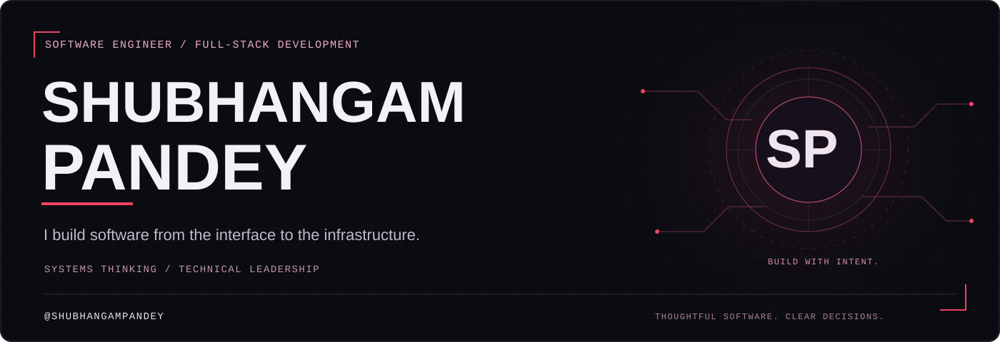
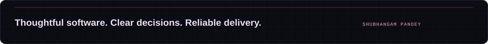

  

<h1 align="center">Hi, I'm Shubhangam Pandey.</h1>

<strong>Software engineer · Full-stack developer · Systems thinker</strong>

  

  
  

<!-- Add your real LinkedIn, email, live portfolio, resume, certificate, and recommendation-letter URLs here when ready. No unfilled links are displayed. -->

## About me

I build software from the **interface to the infrastructure**—bringing together clear user experiences, dependable backend services, and thoughtful system design.

My experience spans **full-stack development, technical team leadership, cloud deployment pipelines, and CI/CD workflows**. My selected work explores distributed incident investigation and policy-driven security for AI agent workflows.

I care about clear responsibilities, inspectable behavior, and software that remains understandable as it grows. I enjoy connecting product details with the engineering decisions underneath them.

## Tech stack

**Languages**

  
  
  
  
  
  

**Frontend**

  
  
  
  
  

**Backend**

  
  
  

**Databases**

  
  
  

**DevOps & cloud**

  
  
  
  

**System design**

HLD/LLD fundamentals · Scalability · Caching · Load balancing

## Professional experience

### UDRcraft Private Limited

**Technical Team Lead Intern** · Remote 
September 2025 – July 2026

- Led Agile delivery across production modules and coordinated engineering work.
- Worked on cloud deployment pipelines, platform reliability, and CI/CD workflow optimization.

### Prodigy InfoTech Private Limited

**Software Engineer Intern** · Remote 
January 2026 – February 2026

## Selected work

### CausalScope · Distributed incident investigation

An investigation workspace connecting OpenTelemetry observations, service topology, trace inspection, and anomaly signals. It brings evidence and uncertainty into the debugging workflow so investigators can examine the reasoning behind a hypothesis.

**Technologies:** TypeScript · React · Express · OpenTelemetry · SQLite · Prisma

### AgentFence · Security for AI agent workflows

A control plane for scoped identities, default-deny policy enforcement, payload-bound independent approval, and inspectable execution evidence. It explores how AI-driven tool use can be governed through explicit backend authorization and auditable decisions.

**Technologies:** TypeScript · React · Express · PostgreSQL · Prisma · OPA/Rego

### ORBITAL · My interactive portfolio

A personal showcase of my work, experience, and technical interests. Interactive project layers, contextual skill summaries, circuit-framed portraits, and synthesized feedback turn the portfolio into an explorable engineering experience.

**Technologies:** TypeScript · Three.js · Vite · CSS · Web Audio API 
**[View portfolio source →](https://github.com/shubhangampandey/orbital-portfolio)**

## GitHub activity

  

## How I work

- **Define the boundaries.** Make responsibilities, contracts, and constraints explicit.
- **Follow the evidence.** Use traces, tests, and observable outcomes to understand behavior.
- **Build for delivery.** Treat deployment and repeatable workflows as part of the design.
- **Explain the system.** Help people understand its state, decisions, and consequences.

## Connect

I'm interested in software engineering, full-stack development, distributed systems, and secure AI integrations. I welcome thoughtful technical conversations and collaboration on software with a clear purpose.

**[GitHub](https://github.com/shubhangampandey)** · **[Explore my repositories](https://github.com/shubhangampandey?tab=repositories)**

  

